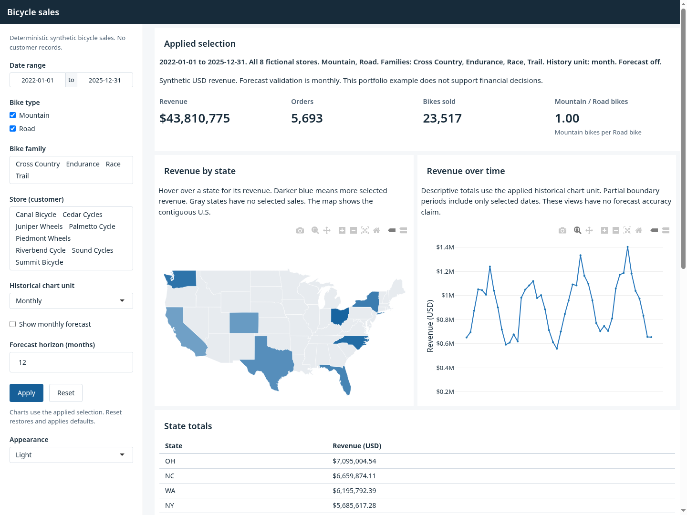
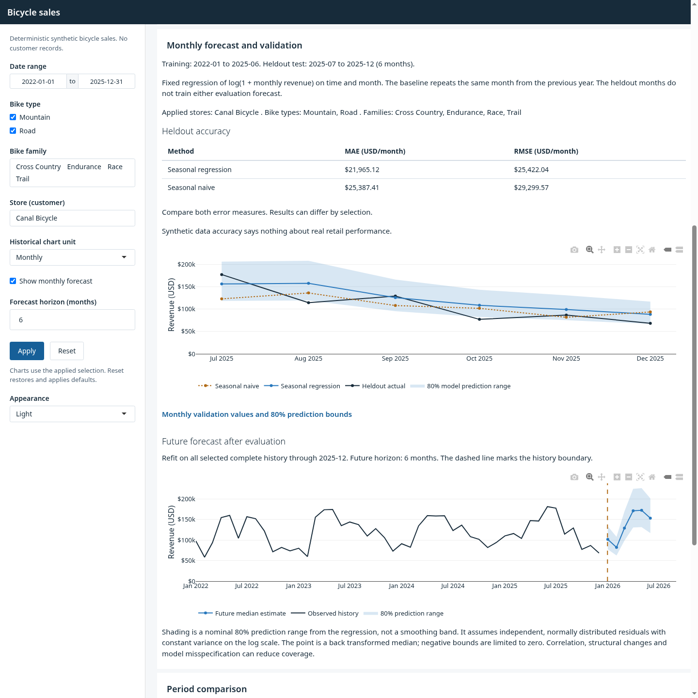
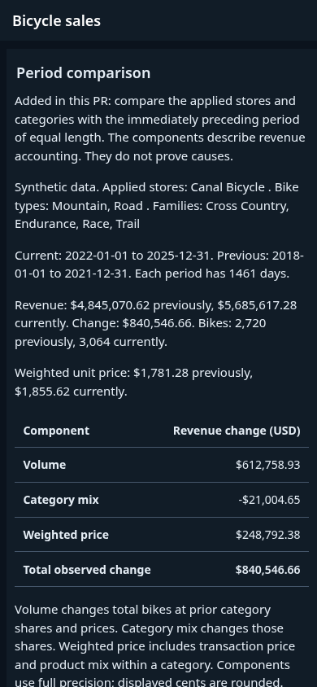

# Bicycle sales dashboard

An R Shiny portfolio dashboard for synthetic bicycle store sales. It keeps flexdashboard, interactive maps, database joins and store, category and date filters. It adds reproducible data, evaluated monthly forecasts and an original explanation of period revenue changes.

The business questions are simple: where did selected sales occur, how did revenue change over time, how well does a modest forecast compare with last year's seasonal pattern, and how much of a period change comes from bike volume, category mix and weighted price?

All data is generated. It contains no customer or personal records. Forecast accuracy on synthetic data says nothing about real retail performance. This example supplies no financial decision guidance.

## Run a fresh checkout

The tested runtime uses R 4.6.1 and Pandoc 3.13. [Tested package versions](docs/tested-packages.tsv) record the 90 installed packages. The earlier Packrat lock and deployment manifest record an R 4.2.2 course environment. They are historical files, not a tested restore path for the current app. The new bootstrap installs only the direct application/test packages and their required dependencies in this checkout. It does not restore all 172 old deployment records.

From the repository root:

```sh
Rscript --vanilla scripts/bootstrap.R
export R_LIBS_USER="$PWD/.runtime/library"
Rscript --vanilla scripts/check_runtime.R
Rscript --vanilla scripts/generate_data.R
Rscript --vanilla scripts/test.R
Rscript --vanilla scripts/validation_report.R
Rscript --vanilla scripts/run_app.R
```

Install Pandoc using the method appropriate to your system. If its directory is outside PATH, set `RSTUDIO_PANDOC` to that directory. The app binds to localhost, port 7431 by default. Set `DASHBOARD_PORT` to another available local port when needed. Stop the R process to close the app.

Source package installation needs an R build toolchain and system development libraries. In particular, fs 2.1.0 required libuv headers and pkg-config in the tested environment. Bootstrap does not install system libraries. Resolve build errors before starting the app.

The explicit generator creates ignored `bikes_database.db`. Its default seed is `20261106`, with complete monthly coverage from 2016 through 2025. An existing database is protected. Use `--overwrite` only to replace a synthetic database you intend to discard. Use `--output` or `--seed` to choose another output or seed. [Data dictionary and zero sales contract](docs/data-dictionary.md).

The runtime check fails clearly if a package or Pandoc is missing. Opening the app without data fails with the generator command; it does not create an empty database. Bootstrap resolves current compatible package releases. Its `.runtime/package-inventory.csv` records the installed versions. It is a local inventory, not a claim that the historical Packrat environment was restored.

## Runtime choices

The app keeps Plotly and flexdashboard. SQLite joins still run before data is collected into R. Direct imports are now explicit: DBI, RSQLite, dplyr, dbplyr, shiny, flexdashboard, plotly and maps. Plotly and rendering packages retain their own required dependencies.

The fixed monthly model uses base R stats instead of the previous XGBoost/calendar feature stack. This removes parsnip, timetk, xgboost and tidyquant from direct requirements and makes evaluation and prediction ranges easier to inspect. Core Shiny widgets replace shinyWidgets and delayed shinyjs clicks. The unused odbc and here imports and the broad tidyverse aggregate are removed. Store/category/date controls, historical time scales and the interactive map remain.

## Use the dashboard

Select dates, bike types, bike families and stores, then choose Apply. Historical aggregation, forecast mode and horizon use the same applied state. Pending or invalid changes leave the previous applied view visible and explain what to fix. Reset restores and applies defaults without a delayed click. Appearance can change independently.

The default window is 2022-2025. The Mountain to Road ratio counts bikes, not lines; a zero Road denominator is unavailable. The map uses local contiguous U.S. polygons and has an accessible state revenue table. Light and dark views share readable labels and keyboard focus styles.

## Forecast validation

The fixed evaluation rule holds out the last six complete selected months, after at least 36 training months. The model is a regression of `log(1 + revenue)` on time and month. The seasonal naive baseline repeats the matching month from the prior year. Both show MAE and RMSE in USD/month. The baseline may win.

Future predictions come from a separate refit on all selected complete history after evaluation. Shading is a nominal 80 percent prediction range from the model, with explicit assumptions. It is not a smoothing ribbon. Validation dates and the future boundary are visible. Forecast accuracy is monthly only; other time units remain descriptive. [Method and assumptions](docs/forecast-method.md).

The default synthetic run uses seed `20261106` and 26,118 order lines. Training covers January 2022 through June 2025. The six heldout months are July through December 2025. These results use all eight stores and all categories:

| Method | MAE (USD/month) | RMSE (USD/month) |
| --- | ---: | ---: |
| Seasonal regression | 59,018.84 | 68,243.95 |
| Seasonal naive | 48,821.70 | 55,449.68 |

The baseline wins on both measures. The model and split were fixed before this run. No tuning followed these results. The future forecast uses a separate refit through December 2025. The default 12 month horizon covers January through December 2026.

The native test suite passed 141 assertions for schema and calendar rules, real isolated SQLite joins and cleanup, Apply/Reset behavior, no leakage, literal baseline errors, independent prediction interval calculations and exact accounting components.

The real browser check passed Apply, invalid horizon refusal, Reset, empty store refusal, retained state through desktop/phone resize, plot containment and visible accounting reconciliation. It observed no external page asset request or JavaScript exception. The phone page width was 390 pixels at a 390 pixel viewport. Measured light body, dark body and dark table heading contrast all exceeded 4.5:1. These checks do not claim a complete accessibility audit.

To repeat the optional browser check, start the synthetic app first. Use an installed Chrome and Node with global WebSocket support (tested with Chrome 156 and Node 26.8.2). Run `DASHBOARD_URL=http://127.0.0.1:7431/ DASHBOARD_EVIDENCE_DIR=.runtime/browser-run-1 node scripts/browser_smoke.mjs`. Choose a new evidence directory for each run. Use a short private TMPDIR if your system's temporary path exceeds Chrome's socket path limit. The script opens a fresh browser profile and closes its owned browser group. Stop the separate R app when finished.

## Actual app views

These captures use the generated data. The overview uses the default eight stores. The forecast and comparison views use Canal Bicycle, the same 2022-2025 date window and a six month future horizon. This selected store has different validation results from the default all store metrics above.

Desktop overview, 1440 by 1080:



Desktop validation and future forecast, 1440 by 1440:



Phone comparison in dark appearance, 390 by 844:



## My contributions

Added in this PR:

- A deterministic synthetic SQLite generator, schema and coverage checks, data dictionary and connection cleanup.
- One applied filter/settings state, useful empty and invalid states, defined ratio units and responsive light/dark styling.
- A fixed time ordered evaluation, seasonal baseline, error metrics and model based prediction ranges.
- An original period comparison that reconciles volume, category mix and weighted price with the exact revenue change. [Accounting definitions and zero cases](docs/revenue-comparison.md).
- Behavioral tests for data, calendars, filters, validation, intervals and accounting.

This project builds on a course dashboard. The exact course title, version and reuse terms have not been supplied. The original history, helper entry point and historical dependency records remain. No repository license is selected by this PR. The owner should confirm course reuse terms before choosing one.

## Existing demo

The existing URL is retained: https://jshield0341.shinyapps.io/sales_dashboard_with_forecasting_app/ . Its current availability and correspondence to this branch are unverified. No hosting or deployment change is part of this work.
